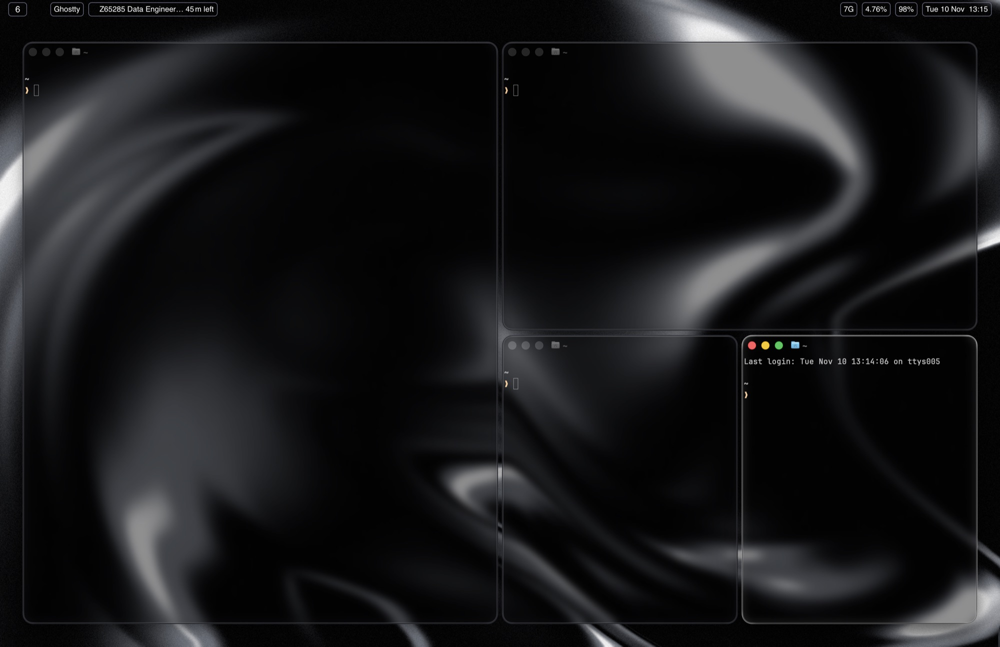
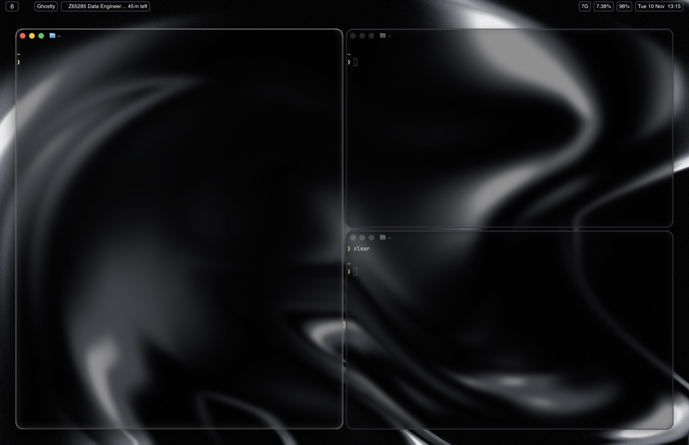
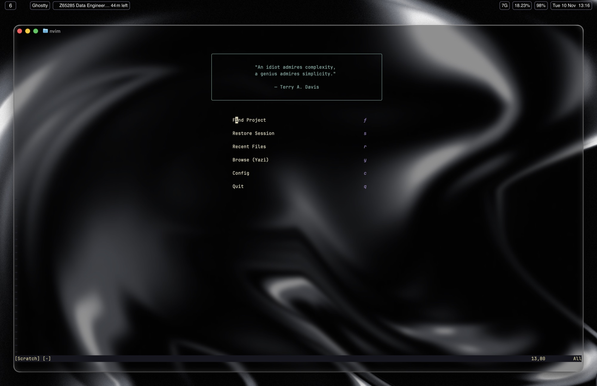
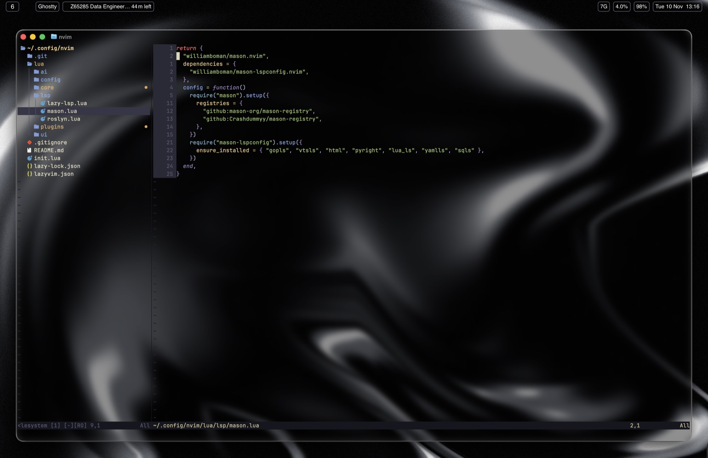
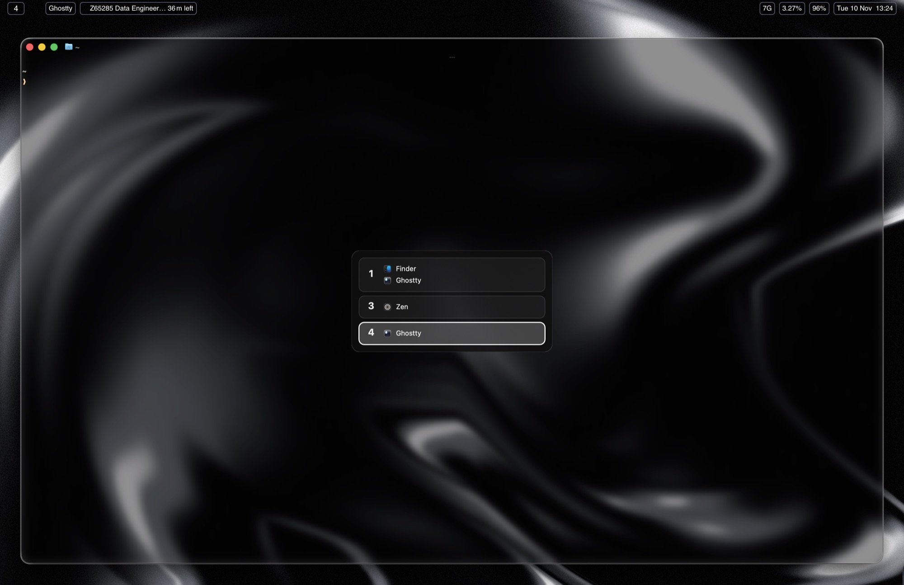
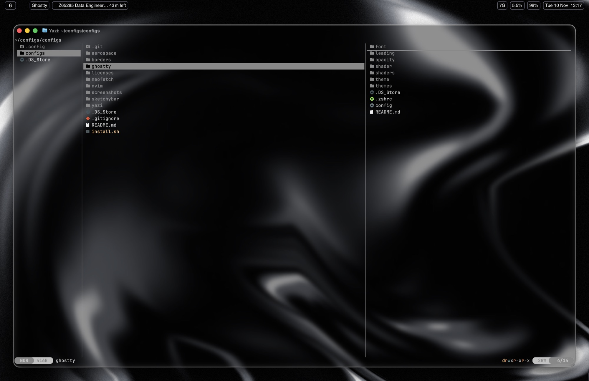

# macOS rice — dotfiles

My macOS desktop setup: a keyboard-driven tiling workflow with translucent
terminals, a transparent Neovim and borders on the focused window.



## What's inside

| Folder | Tool | What it does |
|--------|------|--------------|
| [`aerospace/`](aerospace/) | [AeroSpace](https://github.com/nikitabobko/AeroSpace) | Tiling window manager (i3-like), with a Hyprland-style dwindle layout |
| [`borders/`](borders/) | [JankyBorders](https://github.com/FelixKratz/JankyBorders) | Rounded border around the focused window |
| [`sketchybar/`](sketchybar/) | [SketchyBar](https://github.com/FelixKratz/SketchyBar) | Transparent status bar: workspaces, front app, calendar, clock, battery, CPU, RAM |
| [`hammerspoon/`](hammerspoon/) | [Hammerspoon](https://www.hammerspoon.org) | `opt+space` workspace switcher, and the native menu bar on hover |
| [`ghostty/`](ghostty/) | [Ghostty](https://ghostty.org) | GPU terminal with blur, swappable font/theme/shader snippets and a quick terminal |
| [`nvim/`](nvim/) | [Neovim](https://neovim.io) | Editor config built from scratch with lazy.nvim, LSP, Telescope and Claude Code |
| [`yazi/`](yazi/) | [Yazi](https://github.com/sxyazi/yazi) | Terminal file manager, also embedded in Neovim |
| [`neofetch/`](neofetch/) | [Neofetch](https://github.com/dylanaraps/neofetch) | System info for screenshots |

Each folder has its own README with details and keybindings.

## How it fits together

```
 ┌──────────────────────────── macOS ──────────────────────────────┐
 │                                                                 │
 │  AeroSpace ── tiles every window, 40px outer / 10px inner gaps  │
 │   │  ├─ dwindle.sh: new windows split in a spiral (Hyprland)    │
 │   │  ├─ opt+enter → new Ghostty window                          │
 │   │  └─ workspace change ──► SketchyBar updates workspace label │
 │   │                                                             │
 │  Hammerspoon ── opt+space popup: workspaces + their apps        │
 │   │             mouse at top edge → SketchyBar ⇄ macOS menu bar │
 │   │                                                             │
 │  JankyBorders ── draws a rounded border in the gaps around the  │
 │   │              focused window (light = active, grey = rest)   │
 │   ▼                                                             │
 │  Ghostty (translucent + blur)                                   │
 │   └─ zsh                                                        │
 │       ├─ nvim (kanagawa, transparent bg → Ghostty blur shows)   │
 │       │    └─ yazi.nvim / Claude Code / Telescope / LSP         │
 │       ├─ yazi                                                   │
 │       └─ neofetch                                               │
 └─────────────────────────────────────────────────────────────────┘
```

- **AeroSpace** owns the layout and all `opt`-based shortcuts. It needs no
  SIP changes. The gaps leave room for the borders and let the wallpaper
  show through.
- **SketchyBar** replaces the menu bar with a transparent, blurred bar.
  AeroSpace fires `aerospace_workspace_change` on every switch, and the bar
  shows the visible workspace on each monitor. It also shows the focused app,
  the next Notion Calendar event, and system stats.
- **Hammerspoon** fills two gaps. `opt+space` opens a popup listing every
  workspace and its apps, built from `aerospace list-windows`. When the
  pointer reaches the top edge, it swaps SketchyBar for the native macOS
  menu bar, so app menus are still reachable.
- **JankyBorders** runs as a background service and marks which tile has
  focus, which is hard to see when every terminal is translucent.
- **Ghostty** is the main surface. Its background is see-through and
  blurred, and every TUI inside it (Neovim, Yazi) keeps a transparent
  background so the whole desktop reads as one layer.
- **Neovim** uses `kanagawa-wave` with `transparent = true`, so it picks up
  the Ghostty blur. Yazi opens inside Neovim through `yazi.nvim` (`<leader>-`)
  and from the start dashboard.

## Keybindings

`opt` = Option (⌥). AeroSpace and Hammerspoon capture these system-wide, so
they work in any app.

### Essentials

| Keys | Action |
|------|--------|
| `opt+space` | Workspace switcher popup: `j`/`k` to pick, `enter` to jump, `esc` to close |
| `opt+enter` | New Ghostty window |
| `opt+e` | New Finder window |
| `cmd+ctrl+.` | Ghostty quick terminal (drops down over any app) |

### How to control AeroSpace

AeroSpace keeps each workspace as a **tree of tiles**. You never drag or resize
windows with the mouse:

1. **Open** an app, and it takes a tile. The first two windows sit side by
   side. Each window after that splits the focused tile, alternating
   horizontal and vertical (dwindle).
2. **Move focus** with vim keys: `opt+h/j/k/l`.
3. **Rearrange** by moving the focused window in the tree: `opt+shift+h/j/k/l`.
4. **Organize** apps into workspaces. Each workspace is a key: `1`–`9`, or a
   letter such as `B` for browser or `T` for terminal. `opt+<key>` switches,
   and `opt+shift+<key>` sends the focused window there.
5. **Switch layouts** when tiles get small. Accordion stacks windows and
   leaves a 30px peek of the others.
6. **Service mode** (`opt+shift+;`) is a second layer for rare actions. Most
   actions go back to normal mode right away. After a screenshot, press `esc`.

### Windows

| Keys | Action |
|------|--------|
| `opt+h/j/k/l` | Focus left / down / up / right |
| `opt+shift+h/j/k/l` | Move window left / down / up / right |
| `opt+shift+-` / `opt+shift+=` | Shrink / grow window |
| `opt+/` | Tiles layout (press again to flip horizontal / vertical) |
| `opt+,` | Accordion layout (press again to flip horizontal / vertical) |

### Workspaces

| Keys | Action |
|------|--------|
| `opt+1…9`, `opt+<letter>` | Go to workspace |
| `opt+shift+1…9`, `opt+shift+<letter>` | Move window to workspace and follow it |
| `opt+tab` | Back to the previous workspace |
| `opt+shift+tab` | Move workspace to the next monitor |

Letters `h j k l` handle focus and `e` opens Finder, so those keys don't
switch workspaces.

**One or two monitors:** on one screen, every workspace lives there. With
two, workspaces `1`–`5` go to the secondary display (e.g. an external
monitor) and `6`–`9` to the main one (the display with the macOS menu bar,
e.g. the laptop). Unplugging moves `1`–`5` back to the main display. Details:
[`aerospace/README.md#multi-monitor`](aerospace/README.md#multi-monitor).

### Service mode: `opt+shift+;` then…

| Key | Action |
|-----|--------|
| `esc` | Reload config |
| `r` | Reset the layout (flatten the tree) |
| `f` | Toggle floating / tiling for the window |
| `backspace` | Close every window except the focused one |
| `opt+shift+h/j/k/l` | Join with the neighbor into one container |
| `opt+shift+s` | Screenshot a region to the clipboard |

Full config notes: [`aerospace/README.md`](aerospace/README.md).
Neovim keys: [`nvim/README.md`](nvim/README.md).

## Screenshots

| | |
|---|---|
|  |  |
| Tiling with gaps, borders and SketchyBar | A new window splits the focused tile (dwindle) |
|  |  |
| Neovim dashboard, transparent kanagawa | Neo-tree and LSP config in Neovim |
|  |  |
| `opt+space` workspace switcher (Hammerspoon) | Yazi file manager |

## Installation

### 1. Install the tools

```bash
brew install --cask nikitabobko/tap/aerospace ghostty hammerspoon
brew install FelixKratz/formulae/borders FelixKratz/formulae/sketchybar neovim yazi neofetch
brew install --cask font-sf-pro           # SketchyBar font
brew install git ripgrep fd fzf node      # used by the Neovim config and the Ghostty switcher
```

Neovim also needs Go, Python 3 and a C compiler for some language servers
and Treesitter parsers. See [`nvim/README.md`](nvim/README.md).

You also need a [Nerd Font](https://www.nerdfonts.com) for icons in Neovim
and Yazi. The Ghostty config uses **Lilex** by default.

### 2. Run the installer

```bash
git clone https://github.com/ArtemKucheruk/configs.git ~/configs
cd ~/configs
./install.sh                 # every module
./install.sh nvim ghostty    # only some modules
```

Each module goes to `~/.config/<module>`, except Hammerspoon, which goes to
`~/.hammerspoon`. The script asks how to handle configs you already have:

| Choice | What happens |
|--------|--------------|
| `1` Overwrite | Deletes the existing folder and copies this repo's version in. Skips folders that are git repos, so their history is never wiped |
| `2` Back up | Moves the existing folder to `/tmp/dotfiles-backup-<timestamp>/`, then installs |

> [!WARNING]
> macOS clears `/tmp` on reboot. If you want to keep the backup, copy it
> somewhere else right after installing.

To restore a module from the backup:

```bash
rm -rf ~/.config/nvim && mv /tmp/dotfiles-backup-<timestamp>/nvim ~/.config/
```

### 3. Start everything

```bash
open -a AeroSpace                 # grant Accessibility permission when asked
open -a Hammerspoon               # grant Accessibility; enable "Launch at login"
brew services start borders       # starts JankyBorders, which reads ~/.config/borders/bordersrc
brew services start sketchybar
nvim                              # lazy.nvim installs the plugins on first launch
```

Reload after editing: `aerospace reload-config`, `brew services restart borders`,
`brew services restart sketchybar`, *Reload Config* in the Hammerspoon menu,
and `cmd+shift+,` in Ghostty.

## Repo layout

```
.
├── aerospace/    → ~/.config/aerospace
├── borders/      → ~/.config/borders
├── ghostty/      → ~/.config/ghostty
├── hammerspoon/  → ~/.hammerspoon
├── neofetch/     → ~/.config/neofetch
├── nvim/         → ~/.config/nvim
├── sketchybar/   → ~/.config/sketchybar
├── yazi/         → ~/.config/yazi
├── licenses/     # licenses of bundled third-party files
├── screenshots/
└── install.sh
```
