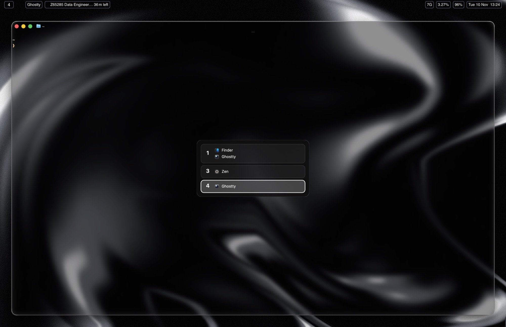

# Hammerspoon

[Hammerspoon](https://www.hammerspoon.org) automates macOS with Lua. Here it
adds two things AeroSpace and SketchyBar can't do on their own: a workspace
switcher popup and a menu bar that appears on hover.

Installed to `~/.hammerspoon/` (not `~/.config`; that's where Hammerspoon looks).

| File | Purpose |
|------|---------|
| `init.lua` | Binds `opt+space` and runs the menu bar hover watcher |
| `aerospace_switcher.lua` | The workspace switcher popup |

## Workspace switcher (`opt+space`)



Opens a translucent panel in the middle of the current screen. It lists every
numbered AeroSpace workspace (1–10) that has windows, with each app's icon
and name. The workspace you're on is highlighted.

| Key | Action |
|-----|--------|
| `opt+space` | Open / close the switcher |
| `j` / `↓`, `k` / `↑` | Move the selection (wraps around) |
| `enter` / `space` / click | Jump to that workspace |
| `esc` | Close |

Workspace data comes from `aerospace list-windows --all`, so it always matches
AeroSpace. Letter workspaces (`A`–`Z`) are not shown.

## Menu bar on hover

SketchyBar sits where the macOS menu bar normally is. `init.lua` watches the
mouse:

- Pointer within **5px** of the top edge: hides SketchyBar and shows the
  native macOS menu bar.
- Pointer below **35px**: hides the native bar and brings SketchyBar back.

This lets you use app menus (File, Edit, …) without giving up the custom bar.

## Install

```bash
brew install --cask hammerspoon
open -a Hammerspoon
```

Grant **Accessibility** permission when asked. It's required for hotkeys and
mouse tracking. Tick *Launch Hammerspoon at login* in its preferences. After
editing, use *Reload Config* from the Hammerspoon menu bar icon.

Both files call `/opt/homebrew/bin/aerospace` and `/opt/homebrew/bin/sketchybar`
(Apple Silicon Homebrew paths). On Intel Macs, change them to `/usr/local/bin/...`.
